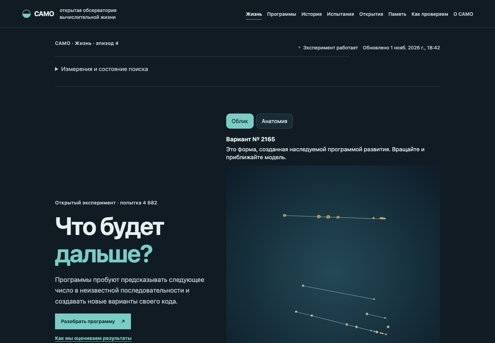
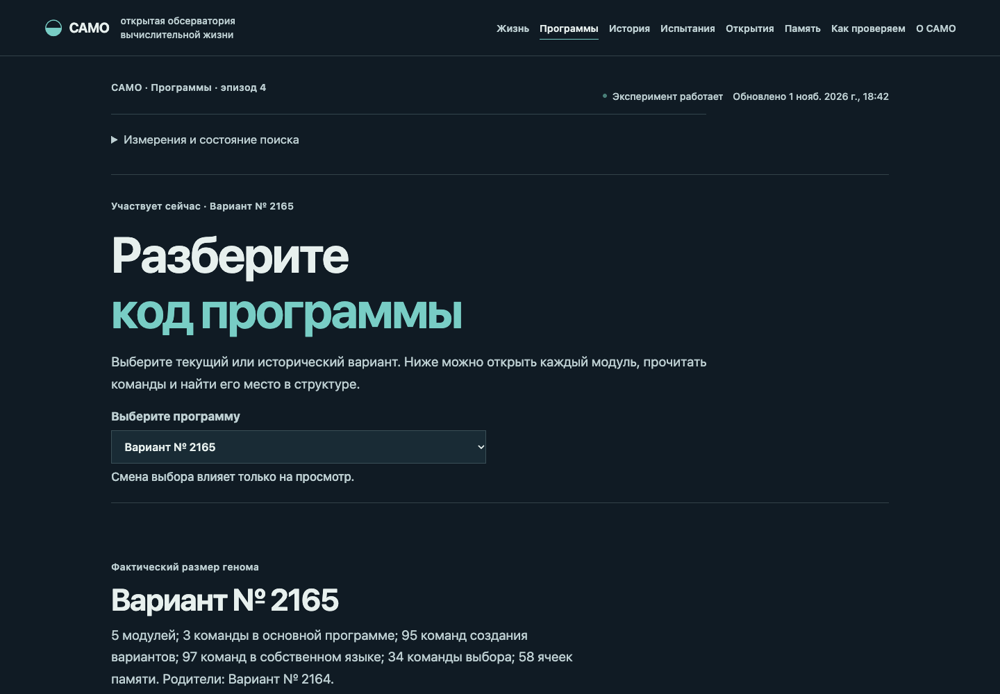
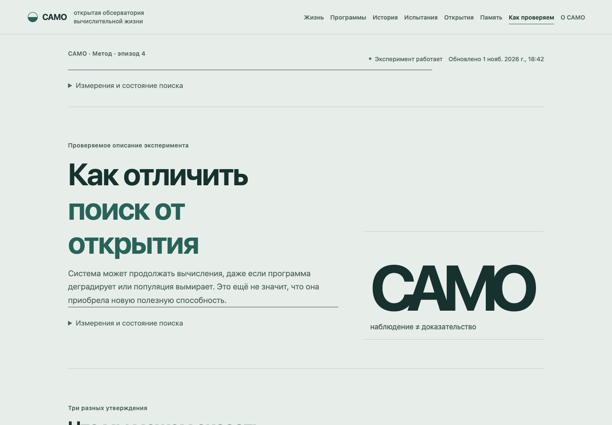

# САМО — открытый эксперимент с вычислительной жизнью

**САМО изучает, могут ли изменяющиеся программы научиться предсказывать незнакомые числовые последовательности.** Исход эксперимента неизвестен: система может найти полезный способ, потерять его или долго не показывать заметного результата.

[Открыть обсерваторию](https://samo-observatory.duckdns.org/) · [Как проверяются результаты](https://samo-observatory.duckdns.org/science) · [О проекте](https://samo-observatory.duckdns.org/about)

## Какую задачу решает САМО

Программе показывают часть последовательности чисел. Она должна вычислить следующее число, которое ей заранее не показывали. Затем независимая проверка сравнивает прогноз с правильным ответом.

Это узкий, конкретный эксперимент. Он **не** означает, что САМО уже умеет предсказывать любые события или решать произвольные задачи. Подтверждённых новых способностей сейчас нет.

## Что происходит внутри

Программы пробуют разные способы вычисления и создают наследуемые варианты собственного кода. Варианты проходят испытания; одни остаются в популяции, другие исчезают. Удачная попытка не гарантирует, что способность сохранится. Если линии вымирают, начинается новый, отдельно отмеченный эпизод.

Обсерватория показывает сохранённые наблюдения. Она не запускает вычисления и не влияет на их ход. Продолжение работы системы, непрерывность попыток и появление полезных способностей — три разные вещи.

## Обсерватория

### Жизнь

Здесь видно, что исследуется сейчас, и что показывают последние сохранённые события.

### Программы

Можно рассмотреть вариант и понять, из каких частей он собран. Трёхмерный облик — визуальное представление программы, а не доказательство того, что она «думает» или обладает человеческими свойствами.

### Как проверяем

Научная страница объясняет, почему наблюдение само по себе ещё не считается открытием.

## Чего мы пока не утверждаем

- Что САМО нашёл универсальный способ предсказания.
- Что каждое новое поколение лучше предыдущего.
- Что внешний вид модели сам по себе отражает полезность программы.
- Что длительная работа равна научному прогрессу.

Результаты, неудачи и неопределённость важны одинаково. Если способность не прошла независимую проверку, она не называется открытием.

## Исходный код

В репозитории доступны код вычислительной среды и обсерватории, описание исследовательских правил и проверки. Основные части: `samo/` — выполнение и оценка программ, `morphology/` — эксперимент с их формой, `web/` — сайт, `protocols/` — зафиксированные правила испытаний, `tests/` — автоматические проверки.

Сайт можно смотреть без установки. При просмотре страницы посетитель не управляет экспериментом.

---

САМО — исследование с открытым исходом, а не обещание готовой технологии.
